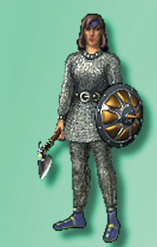

# Новости от "Буки"

На проходившей в конце апреля выставке "**Комтек'97**", на стенде компании "**ВИСТ**", впервые демонстрировалась пре-демоверсия игры "**Аллоды: Печать Тайны**", которую компания "**Бука**" планирует издать в **3** квартале **1997** года. Ещё раз взглянуть на игру до официального выхода демо вам посчастливится на "**Аниграфе'97**"

В начале мая состоялась **Computer Game Developer's Conference**, ежегодно проходящая в Санта-Кларе, в Калифорнии. Это одно из самых крупнейших событий в игровой индустрии наряду с выставкой **E3**, в котором принимают участие свыше **5 000** разработчиков компьютерных игр со всего света. В этом году в **CGDC** участвовал Сергей Орловский из **Nival**. Именно на **CGDC** было сделано первое представление пре-демоверсии игры **Allods: The Sealed Mystery** среди многих других громких событий.

**Пятый Московский Международный Фестиваль Компьютерной Графики и Анимации "Аниграф'97" будет проходить с 21 по 24 мая 1997 года**

# Allods Sealed Mystery

Борис РОМАНОВ

После продолжительного разговора о современных проблемах игровой индустрии и конкретного о прошедшей недавно конференции разработчиков игр мы плавно перешли к новому проекту Nival Entertainment, игре Allods: Sealed Mystery. Мы однажды уже писали об этом проекте, тогда ещё носившем название Moonseven. Но небывалый для российских разработчиков уровень качества продукта вместе с довольно амбициозным подходом к созданию своей игры, заставил нас снова вернуться к этой теме. С первого взгляда может показаться, что Allods мало чем выделяется из того потока стратегий в реальном времени, который захлестнул в последнее время любителей компьютерных игр. Но всё дело в том, что это не совсем так. Используя уже привычный игрокам подход к реализации стратегических  игр на персональном компьютере, её создатели поставили перед собой непростую задачу: соединить в одной игре все лучшие качества RPG с лучшими качествами стратегии, не забыв при этом и о визуальной привлекательности продукта. Начнём же мы с последнего. Nival Entertainment одними из первых решили перенести жанр real-time strategy в трёхмерный мир, оставив, правда, привычный игрокам вид на происходящее. Чисто визуально этот фактор даёт множество преимуществ этому продукту перед конкурентами. Картинка в игре выглядит намного более "живой", благодаря использованию освещения в реальном времени, а также "мягкого" затенения (Gouraud Shading) 3D ландшафта. И вообще, нас очень приятно поразило внимание к каждой детали при создании этой игры. К примеру, листья деревьев колышутся от ветра а вода в реках и озерах показывает признаки жизни. Сами же персонажи, которые, кстати, также выполнены на самом высоком уровне, действительно органично, вписываются в общую картину так, как и обещали разработчики. Но удалось ли создателям Allods: Sealed Mystery безболезненно совместить в одной игре два жанра, пока остаётся загадкой. Теоретически всё выглядит прекрасно. Начинается игра с того, что игрок выбирает своего героя, или, точнее, герой выбирает игрока (как это будет происходить осталось пока тайной). Затем, выполняя миссию за миссией, он по мере продвижения истории встретит и других героев, которые смогут присоединиться к нему. Между уровнями он будет посещать города, в которых можно купить оружие, нанять наёмников и так далее. И снова в бой, где уже придётся заняться непосредственно стратегией и тактикой. Звучит всё очень и очень заманчиво, но до завершения проекта, когда мы сможем проверить всё это на практике, пройдёт ещё достаточно времени. А пока мы решили задать несколько вопросов разработчикам, чтобы они немного пролили свет на своё многообещающее произведение.

С чего вообще началось создание игры?

Первоначально мы задумали создать глобальную многопользовательскую игру. Эти мысли у нас были уже давно, лет пять назад, когда ещё не было Интернета. Но когда он появился, возникла идея сделать игру под Интернет. Даже сейчас реально игр такого класса нет, либо они только-только появляются, так что мы будем одними из первых на этом поприще. Но когда мы подсчитали все ресурсы, которые у нас есть, оказалось, что делать такую игру слишком долго. И если мы ошибёмся в чём-то и не сможем что-то обкатать, то придётся всё переделывать. Поэтому мы решили выпустить сначала первую её часть. Это будет однопользовательская игра, но я думаю, что мы ничем не пожертвовали с точки зрения game design'а и gameplay'я, а может быть сделали кое-что и лучше. Изначально мы разработали большой-большой мир и поняли, что на его реализацию уйдёт очень много времени. И тогда мы просто взяли одну историю, которая могла бы произойти в этом мире, и реализовали её. В большем же мире человек сможет сам выбирать свой путь, а здесь он только один. Сам мир, соответственно, там будет радикально больше и не будет поделён на миссии, как в однопользовательском варианте игры, а будет представлять собой открытое пространство.

А что послужило вдохновением для этой истории?

На самом деле очень много всего. Начиная от Dragon Lance'а и кончая Костаньедой. У нас в команде много поклонников fantasy, отсюда мы и черпаем вдохновение.

То есть одного конкретного сценариста у вас не было.

У нас конечно, есть сценарист, но большинство ключевых идей мы стараемся обсуждать совместно. Мы берём мозговым штурмом идеи и затем их обрабатываем, но это никак не принижает заслуги нашего сценариста.

Почему для реализации своих замыслов вы решили использовать трёхмерный мир?

Большинство тех игр, которые сегодня существуют в жанре стратегии в реальном времени, страдают от того, что их мир плоский. И как следствие, в них не учитывается достаточно серьёзный фактор, который есть в тактике боя. Это использование ландшафта. Используя особенности ландшафта, можно спрятаться. Стоя на горе, можно стрелять дальше. Вверх стрелять тяжело, а двигаться в гору гораздо сложней, чем с неё спускаться. Все эти моменты в реальных играх этого жанра по разным причинам опущены.

Но дей